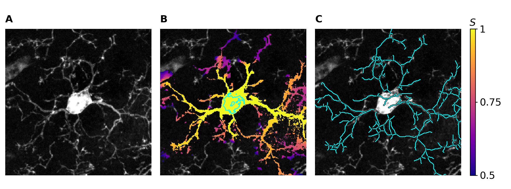
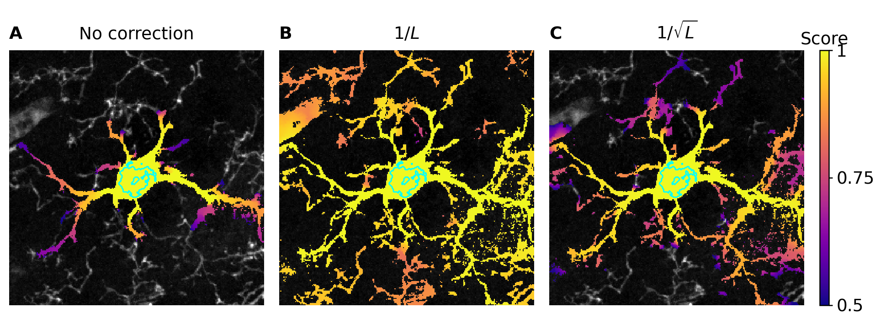

# Random Walk Microglia

Reconstruct individual microglial cells from three-dimensional fluorescence images using soma-specific random-walk connectivity. The method adjusts hitting probabilities for geodesic path length and produces a 3D voxel mask for each reconstructed cell.

This README documents the P28 example, `p28_330_HET_009`, from image preparation in R to reconstruction, evaluation, and manuscript figures in Python.

**Start here:** [Input data](#input-data) · [Run Step01–09](#run-step0109) · [Large-file downloads](#large-file-downloads-and-placement) · [Results](#results)

## Repository layout

```text
Random_Walk_Microglia/
├── README.md
├── notebooks/
│   ├── p28/                         # Step01–09 for the P28 example
│   └── 12hrMD82/                    # Separate sample workflow
├── microglia_hitting/
│   ├── __init__.py
│   └── solver.py                    # Shared hitting-probability solver
├── data/
│   └── p28_330_HET_009/
│       ├── raw/
│       ├── cellpose/
│       └── manual_tracing/
├── results/
│   └── p28_330_HET_009/
│       ├── 01_mgtoolbox_signal/
│       ├── 05_soma_target/
│       ├── 06_active_threshold_selection/
│       ├── 07_reconstruction/
│       ├── 08_evaluation/
│       └── 09_figures/
└── docs/
```

All paths below are relative to the repository root. Keep the original filenames and capitalization when placing downloaded files.

## Get the code and software

Clone the current `main` branch, or use **Code → Download ZIP** on the [repository homepage](https://github.com/mccall-group/Random_Walk_Microglia). Release asset downloads are separate from the code download. The automatically generated source archives on Release pages reflect the tagged commits and may contain older notebooks.

```bash
git clone https://github.com/mccall-group/Random_Walk_Microglia.git
cd Random_Walk_Microglia
```

The repository is currently private; access is required to clone it and download its Release assets.

### R: Step01–05

The recorded R environment used R 4.5.1 and MGtoolbox 0.0.0.9000. Install MGtoolbox using the [MGtoolbox_v2 installation guide](https://github.com/mccall-group/MGtoolbox_v2#quick-start-guide), including its dependencies. Access to that separate repository is required.

The R notebooks also use:

```r
install.packages(c("tiff", "xml2", "mixtools", "ggplot2", "knitr", "rmarkdown"))
```

Open the `.Rmd` files in RStudio and run their chunks in order, or knit them to HTML. The working directory must be the repository root or one of its subdirectories. The notebooks locate the root using `README.md`, `notebooks/`, and `data/`.

### Python: Step06–09

The saved reconstruction records report Python 3.13.5 with the package versions below; the saved figures used Matplotlib 3.10.0.

```bash
python -m venv .venv
source .venv/bin/activate
python -m pip install numpy==2.1.3 scipy==1.15.3 numba==0.61.0 scikit-image==0.25.0 pandas==2.2.3 matplotlib==3.10.0 tqdm jupyterlab
python -m jupyter lab
```

Launch Jupyter from the repository root. Open the notebooks under `notebooks/p28/` and run all cells in order. Keep `microglia_hitting/` at the repository root; the notebooks import the shared solver from there.

These versions describe the saved analysis environment. A complete run from the raw image in a newly installed environment has not yet been verified.

## Input data

The full workflow uses three input files:

| Input | Download | Place at |
| --- | --- | --- |
| Raw 3D fluorescence image | [p28_330_HET_009.tif](https://github.com/mccall-group/Random_Walk_Microglia/releases/download/%60p28-data-v1%60/p28_330_HET_009.tif) | `data/p28_330_HET_009/raw/p28_330_HET_009.tif` |
| Cellpose labels from the 2D projection | [Cellpose label TIFF](data/p28_330_HET_009/cellpose/p28_330_HET_009_2D_projection_masks.tif) | `data/p28_330_HET_009/cellpose/p28_330_HET_009_2D_projection_masks.tif` |
| Manual tracing | [Manual tracing file](data/p28_330_HET_009/manual_tracing/p28_330_HET_009_manual.traces) | `data/p28_330_HET_009/manual_tracing/p28_330_HET_009_manual.traces` |

The raw image is supplied in the [P28 input-data Release](https://github.com/mccall-group/Random_Walk_Microglia/releases/tag/%60p28-data-v1%60). The Cellpose labels and manual tracing are included in the repository.

Step05 uses the Cellpose label to locate the selected soma. Manual tracing supports visual checks and the evaluation in Step08; it does not define the reconstruction target or the analysis region.

## Run Step01–09

Run the files in the following order for the complete P28 analysis. Each Python notebook has its own setup cells and can start in a fresh kernel.

| Step | File | Purpose | Saved output directory |
| --- | --- | --- | --- |
| 01 | [Step01_generate_mgtoolbox_3d.Rmd](notebooks/p28/Step01_generate_mgtoolbox_3d.Rmd) | Read the image, detect somata, and generate the spatially weighted 3D signal. Save the MGtoolbox object, signal, soma tables, and QC images. | `01_mgtoolbox_signal/` |
| 02 | [Step02_check_manual_trace_on_3d_mip.Rmd](notebooks/p28/Step02_check_manual_trace_on_3d_mip.Rmd) | Inspect alignment of the manual tracing with the raw-image and weighted-signal projections. | Displayed plots; no separate result files |
| 03 | [Step03_extract_mg_probability_on_manual_trace.Rmd](notebooks/p28/Step03_extract_mg_probability_on_manual_trace.Rmd) | Inspect weighted-signal values at traced voxels and in their local neighborhoods. | Displayed summaries and plots; no separate result files |
| 04 | [Step04_check_3d_signal_distribution.Rmd](notebooks/p28/Step04_check_3d_signal_distribution.Rmd) | Examine the normalized signal distribution and a three-component Gaussian mixture fit. | Displayed summaries and plots; no separate result files |
| 05 | [Step05_build_3d_soma_target.Rmd](notebooks/p28/Step05_build_3d_soma_target.Rmd) | Normalize the signal, define the soma target and local region, and export the arrays needed by Python. | `05_soma_target/` |
| 06 | [Step06_select_active_threshold.ipynb](notebooks/p28/Step06_select_active_threshold.ipynb) | Compare active thresholds from 0.08 to 0.15 and save the threshold-selection diagnostics. | `06_active_threshold_selection/` |
| 07 | [Step07_reconstruct_p28.ipynb](notebooks/p28/Step07_reconstruct_p28.ipynb) | Compute hitting probabilities and geodesic path lengths, apply the square-root path-length adjustment, and save the final 3D mask. | `07_reconstruction/` |
| 08 | [Step08_evaluate_p28.ipynb](notebooks/p28/Step08_evaluate_p28.ipynb) | Measure manual-trace coverage and compare uncorrected, inverse-length, and inverse-square-root-length scores under matched filtering. | `08_evaluation/` |
| 09 | [Step09_make_p28_figures.ipynb](notebooks/p28/Step09_make_p28_figures.ipynb) | Generate the two combined manuscript PNGs from the saved reconstruction and evaluation results. | `09_figures/` |

All output directories in this table are under `results/p28_330_HET_009/`. Step02–04 are diagnostic checks and are not computational prerequisites for Step05; this is why there are no corresponding `02`, `03`, or `04` result directories.

Step01 saves a weighted image signal. Its legacy filename contains `mg_probability`, but these values are not calibrated cell-membership probabilities. Step05 normalizes this signal for the random-walk calculations.

### Threshold selection and final reconstruction

The saved Step06 selection is `0.12`. Step07 sets `ACTIVE_THRESHOLD = 0.12` explicitly; it does not automatically read `threshold_selection.json`. If selecting a different threshold, update Step07 before running it and then rerun Step08–09.

Step06 uses the screening solver settings defined in that notebook. Step07 performs a separate reconstruction using its own solver settings. Cached Step06 probability maps are diagnostics and do not replace the Step07 calculation.

The current P28 reconstruction uses:

- active threshold: `0.12`;
- signal-weighting exponent: `5`;
- adjusted score: `S = P_hit ** (1 / sqrt(L))`;
- score threshold: `S > 0.5`;
- normalized raw-image MIP intensity threshold: `I > 0.12`;
- minimum connected-component size: `10` voxels, with soma targets retained.

The complete saved settings are in [run_info.json](results/p28_330_HET_009/07_reconstruction/run_info.json). The intensity gate uses the same XY MIP value at every Z slice; reconstruction and manual-trace matching are performed in 3D.

## Large-file downloads and placement

Large reference files are attached to the [P28 reference-results Release](https://github.com/mccall-group/Random_Walk_Microglia/releases/tag/p28-results-v1). Smaller masks, metadata, tables, and figures are stored in the repository. A code ZIP or clone does not include the Release assets.

Download only the files needed for the starting point you choose. Running the full workflow generates these files; downloading every reference asset is not required before starting Step01.

Create missing directories and place each file inside the listed directory without renaming it.

| Step | File download | Destination directory |
| --- | --- | --- |
| 01 | [p28_330_HET_009_mg_probability_3d.rds](https://github.com/mccall-group/Random_Walk_Microglia/releases/download/p28-results-v1/p28_330_HET_009_mg_probability_3d.rds) | `results/p28_330_HET_009/01_mgtoolbox_signal/` |
| 01 | [p28_330_HET_009_stackObj_after_detected_territory.rds](https://github.com/mccall-group/Random_Walk_Microglia/releases/download/p28-results-v1/p28_330_HET_009_stackObj_after_detected_territory.rds) | `results/p28_330_HET_009/01_mgtoolbox_signal/` |
| 01 | [p28_330_HET_009_MDR.RDS](https://github.com/mccall-group/Random_Walk_Microglia/releases/download/p28-results-v1/p28_330_HET_009_MDR.RDS) | `results/p28_330_HET_009/01_mgtoolbox_signal/p28_330_HET_009/MDR/` |
| 05 | [mg_probability_roi_yxz_float32.bin](https://github.com/mccall-group/Random_Walk_Microglia/releases/download/p28-results-v1/mg_probability_roi_yxz_float32.bin) | `results/p28_330_HET_009/05_soma_target/` |
| 06 | Threshold maps: [0.08](https://github.com/mccall-group/Random_Walk_Microglia/releases/download/p28-results-v1/P_hit_t0.08.npy), [0.09](https://github.com/mccall-group/Random_Walk_Microglia/releases/download/p28-results-v1/P_hit_t0.09.npy), [0.10](https://github.com/mccall-group/Random_Walk_Microglia/releases/download/p28-results-v1/P_hit_t0.10.npy), [0.11](https://github.com/mccall-group/Random_Walk_Microglia/releases/download/p28-results-v1/P_hit_t0.11.npy), [0.12](https://github.com/mccall-group/Random_Walk_Microglia/releases/download/p28-results-v1/P_hit_t0.12.npy), [0.13](https://github.com/mccall-group/Random_Walk_Microglia/releases/download/p28-results-v1/P_hit_t0.13.npy), [0.14](https://github.com/mccall-group/Random_Walk_Microglia/releases/download/p28-results-v1/P_hit_t0.14.npy), [0.15](https://github.com/mccall-group/Random_Walk_Microglia/releases/download/p28-results-v1/P_hit_t0.15.npy) | `results/p28_330_HET_009/06_active_threshold_selection/` (keep filenames `P_hit_t0.08.npy` through `P_hit_t0.15.npy`) |
| 07 | [P_hit_zyx.npy](https://github.com/mccall-group/Random_Walk_Microglia/releases/download/p28-results-v1/P_hit_zyx.npy) | `results/p28_330_HET_009/07_reconstruction/` |
| 07 | [L_zyx.npy](https://github.com/mccall-group/Random_Walk_Microglia/releases/download/p28-results-v1/L_zyx.npy) | `results/p28_330_HET_009/07_reconstruction/` |
| 07 | [sqrtL_score_zyx.npy](https://github.com/mccall-group/Random_Walk_Microglia/releases/download/p28-results-v1/sqrtL_score_zyx.npy) | `results/p28_330_HET_009/07_reconstruction/` |
| 07 | [signal_zyx.npy](https://github.com/mccall-group/Random_Walk_Microglia/releases/download/p28-results-v1/signal_zyx.npy) | `results/p28_330_HET_009/07_reconstruction/` |
| 08 | [score_inverse_L_zyx.npy](https://github.com/mccall-group/Random_Walk_Microglia/releases/download/p28-results-v1/score_inverse_L_zyx.npy) | `results/p28_330_HET_009/08_evaluation/` |

The signal RDS contains the weighted 3D image. The `stackObj` RDS contains the MGtoolbox object, including image arrays and soma information. The MDR file is an intermediate soma-detection cache; Step01 reuses it when present at the specified path, or computes it when absent.

### Start directly with Python

To reproduce the Python analysis from the supplied Step05 exports:

1. Download the current repository and install the Python dependencies.
2. Download [mg_probability_roi_yxz_float32.bin](https://github.com/mccall-group/Random_Walk_Microglia/releases/download/p28-results-v1/mg_probability_roi_yxz_float32.bin) into `results/p28_330_HET_009/05_soma_target/`.
3. Check that this directory contains all four Step05 exports:

   ```text
   mg_probability_roi_yxz_float32.bin
   soma_target_roi_yxz_uint8.bin
   raw_mip_roi_yx_float32.bin
   roi_metadata.csv
   ```

   The other three exports are included in the repository.
4. Run Step06, then Step07, Step08, and Step09. With the supplied threshold of `0.12`, Step06 can be skipped if a new threshold scan is not needed.

This route does not require R, MGtoolbox, or the full raw-image TIFF. The manual tracing included under `data/` is still needed for Step08–09.

### Regenerate the figures from saved results

To regenerate the figures without solving the reconstruction again, download these three assets into the directories listed above:

- `P_hit_zyx.npy` → `07_reconstruction/`;
- `sqrtL_score_zyx.npy` → `07_reconstruction/`;
- `score_inverse_L_zyx.npy` → `08_evaluation/`.

Keep the smaller saved masks, tables, JSON records, and manual tracing from the repository, then run Step09. It checks that the Step07 run record matches the snapshot used by Step08.

## Results

### Manuscript figures

Step09 exports two combined PNGs at 300 dpi:

**Raw image, reconstruction, and manual tracing** — [Open PNG](results/p28_330_HET_009/09_figures/p28_reconstruction_panels.png)



**Comparison of the three path-length adjustments** — [Open PNG](results/p28_330_HET_009/09_figures/three_correction_maps.png)



The second figure compares `P_hit`, `P_hit ** (1 / L)`, and `P_hit ** (1 / sqrt(L))` using matched score, intensity, and component filtering. Brighter colors indicate higher selected scores. These displays are axial projections of the 3D results.

### Tables, masks, and run records

| Entry | Contents |
| --- | --- |
| [Step01 results](results/p28_330_HET_009/01_mgtoolbox_signal/) | Weighted-signal summary, soma tables, and QC images; large R objects are in the Release. |
| [Step05 exports](results/p28_330_HET_009/05_soma_target/) | Soma target, raw-image MIP, and ROI metadata; the large signal binary is in the Release. |
| [Threshold comparison](results/p28_330_HET_009/06_active_threshold_selection/active_threshold_comparison.csv) | Step06 diagnostics across candidate thresholds. |
| [Threshold selection](results/p28_330_HET_009/06_active_threshold_selection/threshold_selection.json) | Selected threshold and selection settings. |
| [Final 3D reconstruction mask](results/p28_330_HET_009/07_reconstruction/final_mask_zyx.npy) | Boolean voxel mask in ZYX axis order. |
| [Reconstruction run record](results/p28_330_HET_009/07_reconstruction/run_info.json) | Settings, input references, output filenames, array shape, and software versions. |
| [Manual-trace coverage](results/p28_330_HET_009/08_evaluation/coverage_summary.csv) | Exact 3D traced-voxel coverage and a separate XY projection measure. |
| [Correction comparison](results/p28_330_HET_009/08_evaluation/correction_comparison.csv) | Coverage and reconstruction sizes for the three score definitions. |
| [Evaluation record](results/p28_330_HET_009/08_evaluation/evaluation_info.json) | Trace source, filtering settings, and references to evaluation outputs. |
| [Figure outputs and records](results/p28_330_HET_009/09_figures/) | The two PNGs, copied result tables, and figure provenance. |

For the saved square-root-adjusted reconstruction, 2,092 of 2,491 manually traced voxels within the analyzed ROI were recovered: **83.98% exact 3D coverage**. This denominator includes traced locations that were outside the active domain or left unassigned. The separate XY projection measure should not be substituted for the 3D result.

### Array conventions

Step05 writes R arrays in `YXZ` order as raw binary files, accompanied by `roi_metadata.csv`. The Python notebooks read the recorded dimensions and convert the volumes to `ZYX` order. Saved Python volume arrays use the `_zyx.npy` suffix, and projected images use `_yx.npy`. Use the metadata when mapping ROI coordinates back to the original image.
